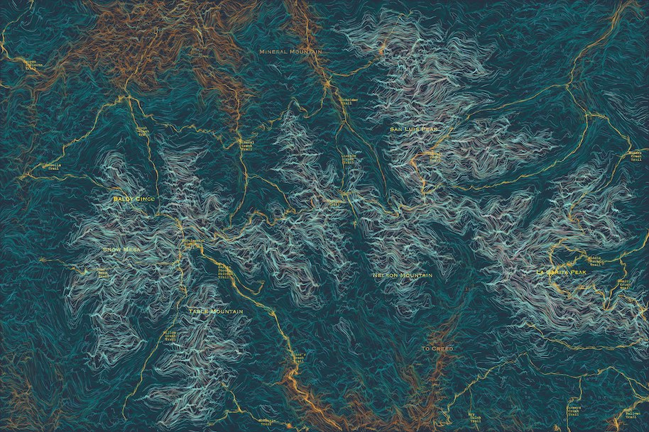

# TopoJoy

TopoJoy generates artistic maps from topographical data.

The colorful lines in the background represent features of the landscape. Lines will follow a river or a mountain ridge, but over some terrain they curve in unpredictable ways. Colors are determined by the elevation of the terrain.

Trails and rivers are sketched to match the style of the background lines, at the expense of accuracy.

## Usage

## Background

The project was inspired by my sister's love of geology and the great enjoyment I got from working with a student on [this tutorial](https://tylerxhobbs.com/essays/2020/flow-fields) by Tyler Hobbs. In the tutorial, you create flow fields with a special kind of computer generated data called [perlin noise](https://en.wikipedia.org/wiki/Perlin_noise). I asked if perlin noise is used to model geographies, why can't geographical data be used as perlin noise?
