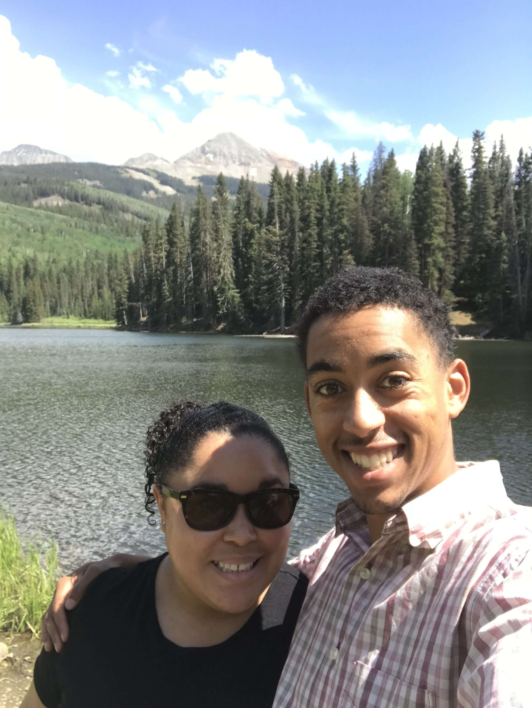
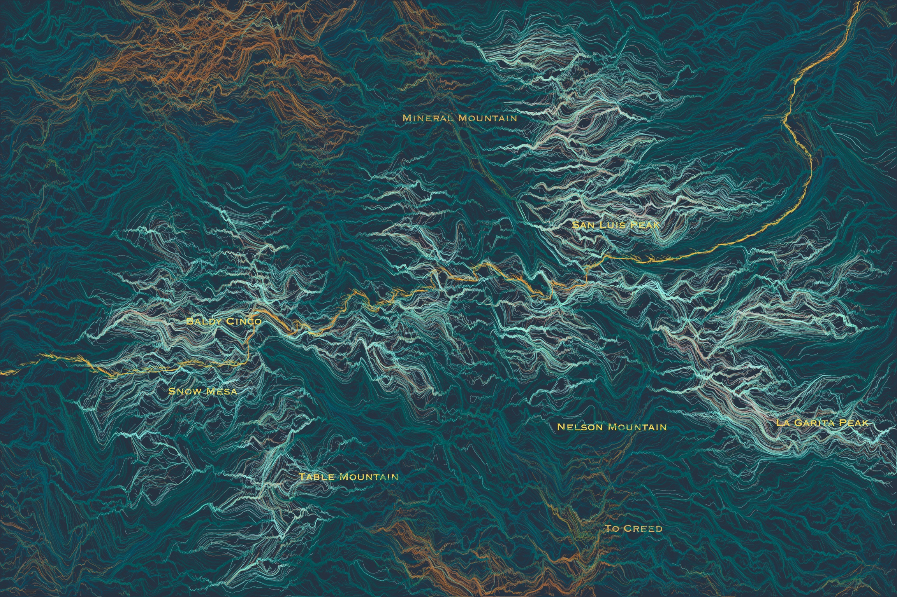

# Origins

{class="w-full rounded-lg sm:float-right sm:ml-6 sm:mb-4 sm:mt-0 sm:w-2/5" loading=lazy}

## The first map

The first map I ever made, the map that kicked off this project, was a gift to my sister. It was a premeditated act of kindness: I figured out her favorite color scheme, the background text was two songs she used to sing to herself on the trail, the location was her favorite trail from summer camp. In the weeks of coding, I found the pleasure of dedicating effort to the happiness of a friend. It was fundamentally an experiment in generosity.

## What should this be?

The project grew. I made maps for more friends, and then my sister figured others might want to make maps too; others might _buy_ them. I had to decide the shape of my project. I had a number of influences that warred in my mind over the year of intermittent building. At first, I wanted profit, naively thinking I could sell enough maps to support myself. I thought of the study I found through Austin Kleon, about how telling a compelling story about an item increased its value on eBay. This mercenary bit of knowledge dovetailed with Start With Why, which said that a strong brand and company is built around a strong "Why." Well, my "why" was all about exploring the power of giving. An important part of the "Why" is that you're true to it; it should guide all your relevant decisions.

{class="w-full rounded-lg sm:float-left sm:clear-both sm:mr-6 sm:mb-4 sm:mt-0 sm:w-2/5" loading=lazy}

## A tool, not a gallery

So what was distinctive about giving these maps that I could share? In a culture of convenience and in a medium of automation and scale–think software vs. hand-painted art–the first maps were an experiment in manual effort and care. Much of my enjoyment came from the labor of tweaking colors, stepping back and reflecting, ah yes, she'll like this. I don't yet have the design chops to make that process of color selection available to the masses, but I could at least enable people to customize their maps in more basic ways: the background text, the location, the chosen features. So, rather than a selection of hardcoded maps, I opted to create a tool.
_update, sept 2026:_ After some user testing, it's become apparent that, while I find the interface quite usable, others got stuck. The new user flow inserts me back in the mix, and I make the map designs for user selection. I use the tool for this, as can anyone else if they want. This means that the maps lose some of the original intended impact, but more people will be able to give gifts. It also means that I'm more involved, which is good for me.

## A Gift

If I was going to advocate for gifting, walking the talk would mean making the maps as free as possible. And it felt better to do so. I still wanted to make money, so at first, I thought of restaurants that allowed customers to pay what they wanted, or posted meals donated by other customers. I figured that such a model worked largely because of social pressure, so when I started designing payments and donations, I considered employing various manipulations to get people to donate: put the donation prompt right after you order, add a price anchor, show what other people gave. There's a playbook. These ultimately put profit first and the purity of a gift second. I decided to let them go. In the theory of gifts that I subscribe to, this separation of gift from the expectation of return is necessary for it to count as a true gift.

## An exclusive club?

I also wrestled with fantasies of an exclusive membership: here the temptation wasn't so much profit, but that demon, "cool." Wouldn't it increase the allure of the maps if the only way to get one is through a recommendation? This errant intention still rides: I still want TopoJoy maps to be "cool." But there were better reasons for a more exclusive model as well: the maps would be a truer symbol of generosity and community if the only way to get one is through a chain of gifts. It also made it easier to engender the desired attitude, convey the right perceptions, to those whom I now think of as collaborators in the TopoJoy project. So, I removed the payable storefront completely; only recipients of a donation would be able to print a map through the website.

## Standing on generosity

As it developed, other values began to take the fore. In place of profit, I saw an opportunity to participate in the economy of gifts, and to honor the generosity of my teachers and benefactors. My Mom, whom I depend on, and who encouraged me to stay true. Than Ajahn Geoff, who ignited my interest in generosity, gratitude, and so many other wholesome qualities. A camp director, Michael "Gus" Gustafson, who had us dress up as rebels and gather horse manure into a message that could be read from across the valley, saying, "We love you, wranglers!" We struck our own path, but we went in the direction of kindness. The spirit of countercultural generosity lives on in these maps. Andrew Todhunter, who took us winter camping in Yosemite, my first meditation teacher; his generosity and love of wilderness are in these maps. The community of cartographers; their free software and services form the foundation for this experiment. Tyler Hobbs, a computer artist who wrote a free tutorial that inspired the style of the maps. This is an echo of their generosity.
